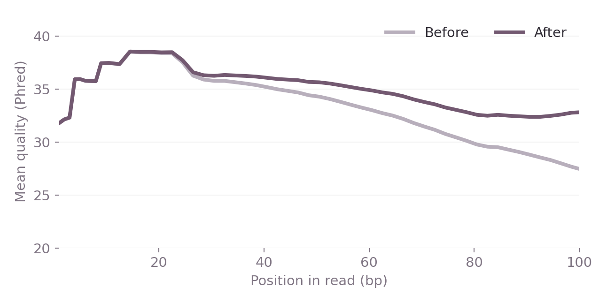

# University CS Topics — RNA-seq Project

A university course project for **Topics in Computer Science**, implementing a single-end human RNA-seq workflow from raw reads to a gene count table.

**Team:** Ali Mohammad Gholizadeh · Hesam Javadi  

[Presentation (Persian)](Presentation.pdf) · [Oral defense guide (Persian)](docs/Defense_Guide.md) · [Analysis summary](results/analysis_summary.json)

## Project objective

Run the instructor's prescribed workflow on the complete input dataset, inspect the outputs, and explain the purpose and results of each processing step. This is an educational analysis of one sample; it does not include differential expression analysis.

## Workflow

| Stage | Tool | Main input | Main output |
|---|---|---|---|
| Initial quality control | FastQC | `demo.fastq` | HTML and ZIP reports |
| Quality trimming | Trimmomatic 0.39 | `demo.fastq` | `demo_trimmed.fastq` |
| Post-trimming quality control | FastQC | `demo_trimmed.fastq` | HTML and ZIP reports |
| Alignment to GRCh38 | HISAT2 | Trimmed reads and genome index | `demo.sam` |
| Sorting and indexing | samtools | `demo.sam` | `demo.sorted.bam` and `.bai` |
| Gene-level counting | featureCounts | Sorted BAM and GTF annotation | `demo_counts.txt` and `.summary` |

The original input remains unchanged. All processing outputs are separate files.

## Results

These values come from the actual full-dataset run, not simulated data.

| Metric | Value |
|---|---:|
| Raw reads | 1,250,000 |
| Original read length | 100 bp |
| Reads retained after trimming | 1,249,800 |
| Overall alignment rate | 93.07% |
| Reads assigned to genes | 913,764 |
| Genes in the count table | 61,552 |
| Genes with nonzero counts | 17,875 |

featureCounts assigned **63.89% of 1,430,243 alignment records**. The assigned count is also **73.11% of the 1,249,800 retained reads**. These percentages have different denominators: some reads produce multiple alignment records.



The chart compares mean quality by read position. After trimming, only reads that still reach a position contribute to its quality statistics.

## Environment and dependencies

The analysis was performed on a **MacBook M1 with 8 GB RAM**, using Docker Desktop and native **Linux ARM64** containers.

| Tool | Version used |
|---|---|
| FastQC | 0.11.9 |
| Trimmomatic | 0.39 |
| HISAT2 | 2.2.1 |
| samtools | 1.16.1 |
| featureCounts / Subread | 2.0.3 |
| Python | 3.11.2 |
| Java | OpenJDK 17 |

Install Docker Desktop with Docker Compose. The Dockerfile installs the bioinformatics tools, Java, and Python inside the container; native installations are unnecessary.

`requirements.txt` intentionally contains no pip dependencies: the pipeline orchestrator uses only the Python standard library. Bioinformatics dependencies are specified in `Dockerfile`.

The Docker configuration targets ARM64. Other architectures have not been validated. Exact Debian package versions are pinned, but their continued availability from online repositories is not guaranteed.

## Input data and reference

Place the instructor-provided input at `data/demo.fastq`. The raw dataset is not distributed in this repository.

Expected input SHA-256:

```text
4e557461b7f65e8cbfa3ce315d16fda98947fc5b52e8d0cf9c9945afa266b297
```

References:

- [HISAT2 GRCh38 genome index](https://genome-idx.s3.amazonaws.com/hisat/grch38_genome.tar.gz)
- [Ensembl release 106 GTF](https://ftp.ensembl.org/pub/release-106/gtf/homo_sapiens/Homo_sapiens.GRCh38.106.gtf.gz)

The script downloads references when needed in run mode and checks their recorded hashes. These hashes document the files used in this project; they are not independent publisher signatures.

## Running from a fresh checkout

Run the following from the repository root **after placing the input FASTQ in `data/`**:

```bash
docker compose build
bash run_pipeline.sh --run
```

Outputs are written directly to the host project directory through a bind mount. The raw FASTQ is additionally mounted read-only. Data and reference files are not copied into the Docker image.

Allow approximately 20 GiB of initial free disk space for a fresh run, including reference archives, extracted files, outputs, and working headroom. The script checks available space before expensive operations. The successful original alignment used 6.74 GiB of memory visible to Docker; this is not a universal resource guarantee.

## Checking an existing completed run

Merge the repository's code and documentation into the existing project directory without deleting local data, references, reports, or the Trimmomatic JAR. Then run:

```bash
bash run_pipeline.sh --verify-existing
```

Successful completion prints `PIPELINE_VERIFIED_OK`. This mode validates existing files and records checkpoints without rerunning the scientific analysis or downloading references. Hashing large files can take several minutes.

In subsequent `--run` invocations, stages with matching validated checkpoints are skipped. Changed inputs or outputs cause the script to stop. Incomplete outputs are not automatically deleted.

**Validation status:** the original scientific workflow was executed on the full dataset. Script syntax and selected validation logic were checked during packaging; an end-to-end execution of the final wrapper on the student's Mac still requires confirmation.

**Scope:** this script is deliberately tied to the instructor's dataset, checksum, tool versions, and expected results. It is not a general-purpose pipeline for arbitrary FASTQ files.

## Prescribed scientific parameters

```bash
java -jar tools/trimmomatic-0.39.jar SE -threads 4 -phred33 \
  data/demo.fastq data/demo_trimmed.fastq TRAILING:10

hisat2 -q --rna-strandness R -x reference/grch38/genome \
  -U data/demo_trimmed.fastq -S data/demo.sam

samtools sort -o data/demo.sorted.bam data/demo.sam
samtools index data/demo.sorted.bam

featureCounts -s 2 -a reference/Homo_sapiens.GRCh38.106.gtf \
  -o data/demo_counts.txt data/demo.sorted.bam
```

These commands execute inside the container through the pipeline. `TRAILING:10` removes consecutive low-quality bases from the 3′ end until a base with quality at least Q10 is reached. It does not mean removing exactly ten bases. Reverse-stranded settings follow the assignment.

## Repository layout

| Path | Purpose |
|---|---|
| `run_pipeline.sh` | Pipeline entry point |
| `tools/pipeline.py` | Execution, validation, logging, and checkpoints |
| `Dockerfile`, `compose.yaml` | Tool environment and host mounts |
| `requirements.txt` | Explanation of Python dependency requirements |
| `data/` | Local reads and working outputs; ignored by Git |
| `reference/` | Local genome index and annotation; ignored by Git |
| `reports/` | Local quality-control reports and logs; ignored by Git |
| `results/` | Small, verified result copies for inspection |
| `figures/` | Charts derived from the actual dataset |
| `Presentation.pdf` | Persian course presentation |
| `docs/` | Execution notes and oral defense material |
| `.github/workflows/checks.yaml` | Syntax and configuration checks |

## Checks

```bash
bash -n run_pipeline.sh
python3 -m py_compile tools/pipeline.py
docker compose config --quiet
```

GitHub Actions runs syntax and configuration checks only. It does not contain the input dataset or perform a full RNA-seq validation.

## Limitations

- This is a single-sample educational project without biological replicates or comparison groups.
- Raw counts are not normalized expression values.
- Reverse-strandedness was prescribed, not independently established.
- FastQC warnings need interpretation; they do not automatically invalidate a dataset.
- No additional minimum-length or adapter-removal filter was introduced beyond the instructor's parameters.
